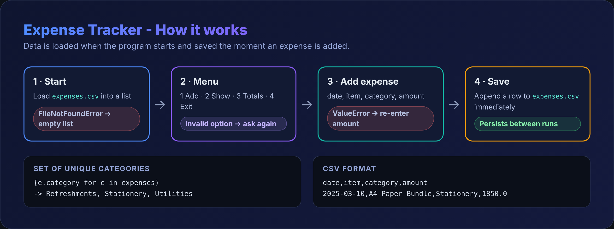
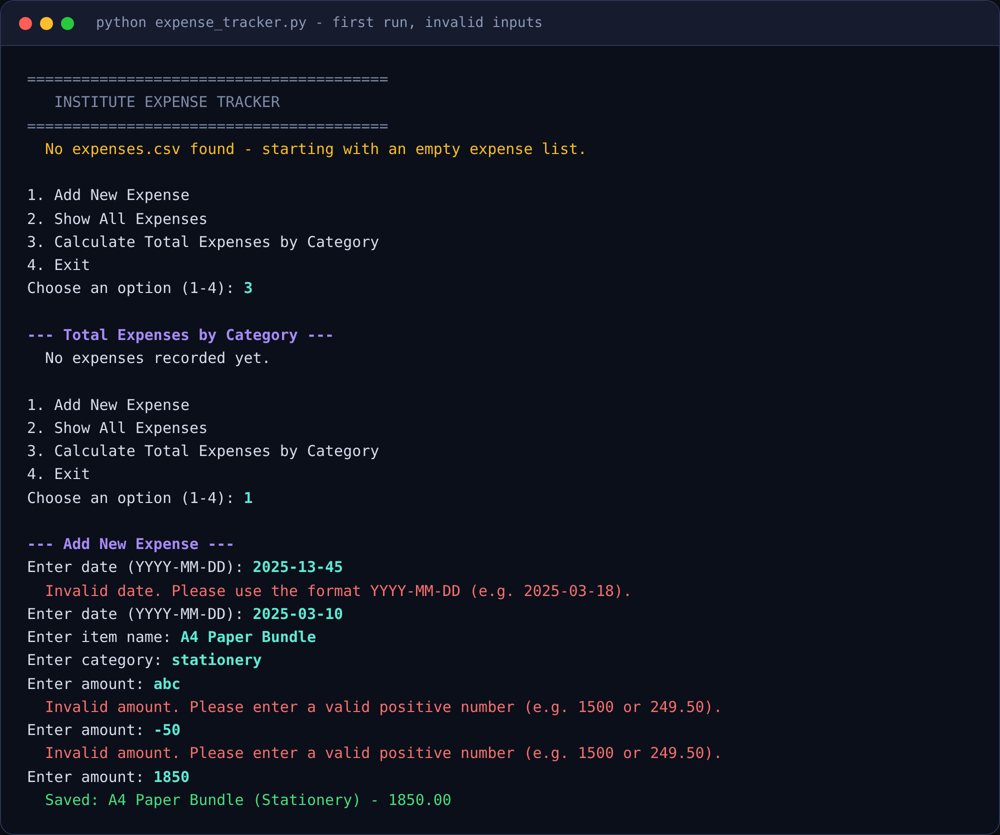
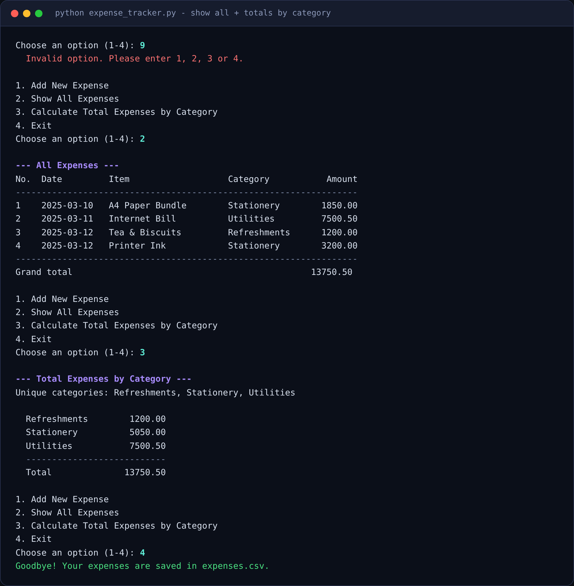
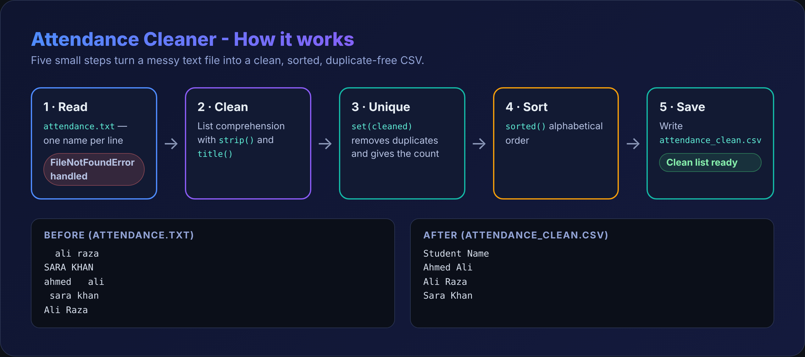
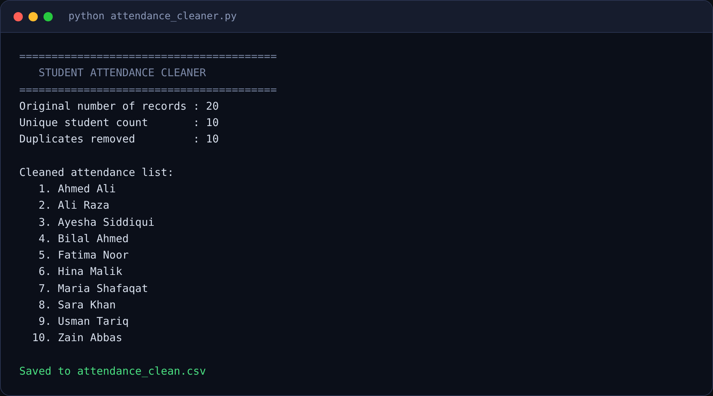
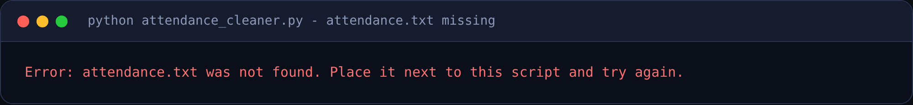
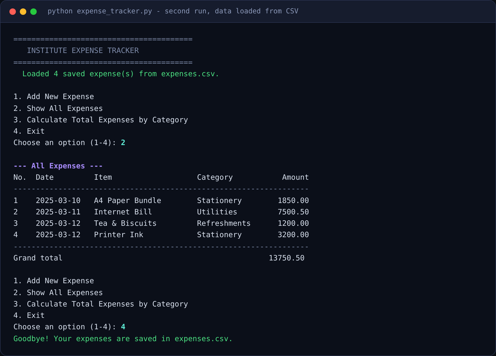

<div align="center">


**Assessment 4 - Python Files, Errors, Sets & Comprehensions**
**[Live Project Preview](https://claude.ai/artifact/EbdUPpE8MoNfWR7L3xSp8R)**

</div>

---

## Table of Contents

1. [Overview](#1-overview)
2. [Repository Structure](#2-repository-structure)
3. [How to Run](#3-how-to-run)
4. [Task 1 - Institute Expense Tracker](#4-task-1---institute-expense-tracker)
5. [Task 2 - Student Attendance Cleaner](#5-task-2---student-attendance-cleaner)
6. [Errors Handled and Why](#6-errors-handled-and-why)
7. [How Sets and List Comprehensions Are Used](#7-how-sets-and-list-comprehensions-are-used)
8. [Sample Run - Data Is Saved and Loaded Again](#8-sample-run---data-is-saved-and-loaded-again)
9. [Test Cases](#9-test-cases)
10. [Output Files](#10-output-files)
11. [Author](#11-author)

---

## 1. Overview

This repository contains two small management tools for a training institute, built with Python's **file handling**, **exception handling**, **sets** and **comprehensions**.

| Program | Purpose |
|---|---|
| `expense_tracker.py` | Records daily operational expenses (stationery, internet bills, refreshments, transport) in `expenses.csv`, shows them, and totals them by category. Data is saved immediately and loaded again on the next run. |
| `attendance_cleaner.py` | Cleans a messy `attendance.txt` (extra spaces, wrong capitalization, repeated names), removes duplicates, sorts alphabetically and saves `attendance_clean.csv`. |

Only the Python standard library is used (`csv`, `os`, `datetime`), so nothing needs to be installed.

---

## 2. Repository Structure

```text
python-files-errors-assessment/
│
├── expense_tracker.py       # Task 1
├── attendance_cleaner.py    # Task 2
├── attendance.txt           # Messy sample input for Task 2
├── README.md                # This file
└── assets/                  # Banners, diagrams and screenshots used in this README
    └── html/                # HTML sources of every image (open in a browser)
```

`expenses.csv` and `attendance_clean.csv` are **created automatically** when the programs run.

---

## 3. How to Run

**Requirements:** Python 3.8 or newer.

```bash
# 1. Clone the repository
git clone https://github.com/<your-username>/python-files-errors-assessment.git
cd python-files-errors-assessment

# 2. Task 1 - Expense Tracker
python expense_tracker.py

# 3. Task 2 - Attendance Cleaner
python attendance_cleaner.py
```

> On some systems use `python3` instead of `python`.

---

## 4. Task 1 - Institute Expense Tracker




**Menu**

```text
1. Add New Expense
2. Show All Expenses
3. Calculate Total Expenses by Category
4. Exit
```

**Features**

- Stores data in `expenses.csv` with the columns `date,item,category,amount`.
- Loads saved expenses on start-up; if the file is missing it starts with an empty list.
- Validates the date (`YYYY-MM-DD`) and the amount (must be a positive number) and asks again until valid.
- Saves every new expense to the CSV file **immediately**, so nothing is lost if the program is closed.
- Option 3 shows all **unique categories** (using a set) and the total per category.

### Adding expenses and handling invalid input



### Show all expenses and totals by category



---

## 5. Task 2 - Student Attendance Cleaner




**What it does**

1. Reads `attendance.txt` (one name per line, blank lines ignored).
2. Cleans each name with `strip()` and `title()` inside a **list comprehension**.
3. Builds a **set** to find the unique students and count them.
4. Sorts the names alphabetically.
5. Saves the result to `attendance_clean.csv` and prints the summary.



---

## 6. Errors Handled and Why

| Error | Where | Why it is handled | What the program does |
|---|---|---|---|
| `FileNotFoundError` | `expense_tracker.py` → `load_expenses()` | On the very first run `expenses.csv` does not exist yet. This is normal, not a failure. | Prints a message and starts with an empty expense list. |
| `ValueError` (amount) | `expense_tracker.py` → `ask_amount()` | `float("abc")` raises `ValueError`. Bad input must not crash the program or corrupt the CSV file. | Shows an error and asks for the amount again. Negative and zero amounts are rejected too. |
| `ValueError` (date) | `expense_tracker.py` → `ask_date()` | `datetime.strptime` raises `ValueError` for impossible dates such as `2025-13-45`. | Asks for the date again. |
| `FileNotFoundError` | `attendance_cleaner.py` → `read_names()` | If `attendance.txt` is missing or in the wrong folder, a traceback would confuse the user. | Prints a clear message and stops cleanly. |
| Damaged CSV row (`KeyError` / `ValueError`) | `expense_tracker.py` → `load_expenses()` | A manually edited CSV may contain a broken row; one bad row should not block all the others. | Skips only that row and warns the user. |



---

## 7. How Sets and List Comprehensions Are Used

### Sets - unique values only

A set stores each value **once**, which removes duplicates automatically.

```python
# expense_tracker.py - unique expense categories
categories = {e["category"] for e in expenses}
print("Unique categories:", ", ".join(sorted(categories)))
```

```python
# attendance_cleaner.py - unique students and their count
unique_students = set(cleaned)
print(len(unique_students))
```

### List comprehensions - clean data in one line

```python
# attendance_cleaner.py - strip() removes extra spaces, title() fixes capitalization
cleaned = [" ".join(name.strip().split()).title() for name in raw_names]
```

| Raw line in `attendance.txt` | After cleaning |
|---|---|
| `"  ali raza"` | `Ali Raza` |
| `"SARA KHAN"` | `Sara Khan` |
| `"ahmed   ali"` | `Ahmed Ali` |

`split()` / `join()` is added so that repeated spaces **inside** a name (`ahmed   ali`) do not create a false duplicate.

A dictionary comprehension is also used for per-category totals:

```python
totals = {
    category: sum(e["amount"] for e in expenses if e["category"] == category)
    for category in categories
}
```

---

## 8. Sample Run - Data Is Saved and Loaded Again

**Run 1** - expenses are added (see the screenshots in [Task 1](#4-task-1---institute-expense-tracker)) and written to `expenses.csv`:

```csv
date,item,category,amount
2025-03-10,A4 Paper Bundle,Stationery,1850.0
2025-03-11,Internet Bill,Utilities,7500.5
2025-03-12,Tea & Biscuits,Refreshments,1200.0
2025-03-12,Printer Ink,Stationery,3200.0
```

**Run 2** - the program is started again. It loads the 4 saved expenses automatically:



---

## 9. Test Cases

### Task 1 - Expense Tracker

| # | Test | Input | Expected result | Result |
|---|---|---|---|---|
| T1 | First run, no CSV file | Start program | "No expenses.csv found - starting with an empty expense list." No crash | Pass |
| T2 | Show / totals with no data | Option `2` or `3` | "No expenses recorded yet." | Pass |
| T3 | Invalid amount (text) | `abc` | Error message, amount asked again | Pass |
| T4 | Invalid amount (negative) | `-50` | Error message, amount asked again | Pass |
| T5 | Invalid amount (empty) | *(Enter)* | Error message, amount asked again | Pass |
| T6 | Invalid date | `2025-13-45` | Error message, date asked again | Pass |
| T7 | Valid expense | `2025-03-10`, `A4 Paper Bundle`, `stationery`, `1850` | Saved; category stored as `Stationery` | Pass |
| T8 | Decimal amount | `7500.50` | Accepted and stored as `7500.5` | Pass |
| T9 | Category in different case | `STATIONERY` after `stationery` | Treated as the same category | Pass |
| T10 | Invalid menu option | `9` | "Invalid option. Please enter 1, 2, 3 or 4." | Pass |
| T11 | Unique categories (set) | Option `3` | `Refreshments, Stationery, Utilities` - each once | Pass |
| T12 | Total by category | Option `3` | Stationery `5050.00`, Utilities `7500.50`, Refreshments `1200.00`, total `13750.50` | Pass |
| T13 | Persistence | Exit, run again, option `2` | All 4 expenses loaded from `expenses.csv` | Pass |

### Task 2 - Attendance Cleaner

| # | Test | Input | Expected result | Result |
|---|---|---|---|---|
| T14 | Extra spaces | `"  ali raza"` | `Ali Raza` | Pass |
| T15 | Inconsistent capitalization | `"SARA KHAN"` | `Sara Khan` | Pass |
| T16 | Duplicate names (different formatting) | `ali raza`, `Ali Raza`, `  ali raza` | Counted once | Pass |
| T17 | Record counts | Provided `attendance.txt` | Original records `20`, unique students `10`, duplicates removed `10` | Pass |
| T18 | Missing input file | Rename `attendance.txt` | Friendly error message, no traceback | Pass |

To reproduce the invalid-amount test quickly:

```bash
printf '1\n2025-03-10\nPen\nstationery\nabc\n-5\n150\n4\n' | python expense_tracker.py
```

---

## 10. Output Files


---

## 11. Author

**Maria** - Software Engineering graduate | Aspiring Web Developer

Built as part of **Assessment 4 - Personal Finance & Student Attendance Management System**.
